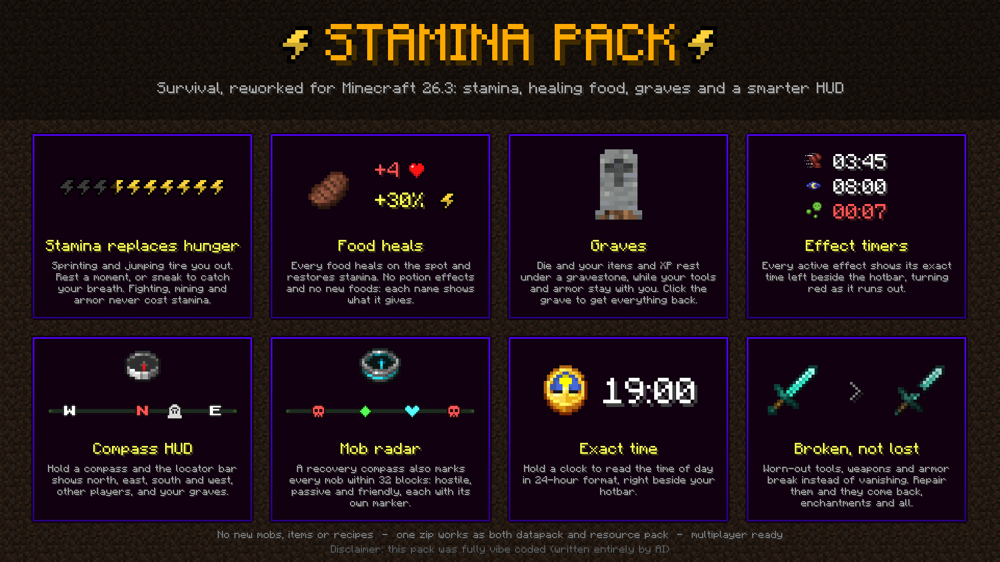
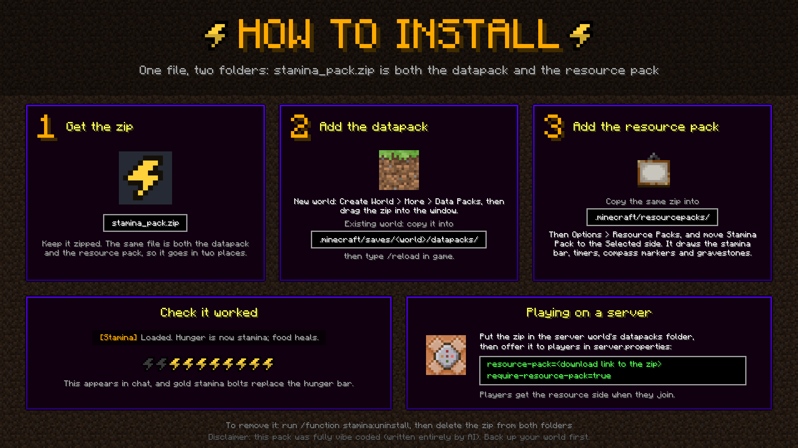

# Stamina Pack (Minecraft 26.3)



A vanilla-compatible survival rework in a single zip that is both a datapack and a resource pack.

> **Disclaimer:** this pack was fully vibe coded. Every function, script, texture and model in it was written by an AI (Claude) from plain-language requests, and tested on a headless server and in play rather than reviewed line by line. It works as far as it has been tested, but expect rough edges, and back up your world before adding it.

## Features

- **Stamina instead of hunger.** Sprinting and jumping cost stamina, and it recovers on its own after a second without spending. Sneaking makes it recover faster. Nothing else costs stamina: attacking, mining, bows, shields and armor are all untouched. At 0 you're exhausted: you can't sprint and you're slowed until the bar is back to 20%.
- **Food heals directly and restores stamina.** It doesn't add any potion effects, and there are no new foods or potions. Health only comes back from food, because vanilla natural regeneration never triggers. Every food's name shows what it gives, for example "Steak +4❤ +30%⚡".
- **Graves, with your gear kept.** When you die you keep your worn armor, your tools, weapons and anything else with durability (bows, shields, elytra, fishing rods...), and your compasses, clocks and spyglasses. Everything else, and your experience, is buried in a headstone at the death spot; click it to get it all back into the slots it came from. Only you can open your own grave (configurable). Curse of Vanishing items are destroyed.
- **Effect timers on the HUD.** Each active effect shows its icon and time left (mm:ss) in a column beside the hotbar, turning red in the last 10 seconds.
- **A compass on the HUD.** While you hold a compass or recovery compass in either hand, the locator bar replaces the experience bar. It shows N/E/S/W markers that follow you, your graves and other players. Put the compass away and the experience bar comes back.
- **Recovery compass: mob radar.** It does everything a compass does, and also marks every mob within 32 blocks on the locator bar: hostile mobs as red skulls, animals as green diamonds, and friendly mobs (villagers, wandering traders, golems, allays and any tamed animal) as aqua hearts. Fish, squid, tadpoles and bats are left out so oceans and caves don't flood the bar; the lists are the entity tags `hostile`, `passive` and `friendly` in `data/stamina/tags/entity_type/`. In multiplayer, a player with a plain compass standing near you sees the same markers (the game can't show a waypoint to one player only).
- **Clocks show the exact time.** While you hold a clock in either hand, the time of day appears left of the hotbar as 24-hour HH:MM (sunrise is about 06:00, nightfall about 19:00). Outside the Overworld it reads --:--.
- **Broken, not destroyed.** A tool, weapon or piece of armor that runs out of durability becomes Broken instead of vanishing: a cracked, dulled version of itself that does nothing (and can't be worn) until repaired, keeping its name, trims and enchantments (which sleep until it's fixed). Repair it any vanilla way: an anvil with its material, combining two in a crafting grid, or a grindstone. Set `#durability` to 0 in the config for vanilla breaking.

There are no new mobs, mob changes, items, recipes or enchantments.

## Install

Download `stamina_pack.zip` from the [Releases](../../releases) page.



`stamina_pack.zip` is both the datapack and the resource pack. Put the same file in both places:

1. **Datapack:** when creating a world, open **Data Packs** and drop it in. For an existing world, copy it into `saves/<world>/datapacks/` and run `/reload`.
2. **Resource pack:** copy it into `.minecraft/resourcepacks/` and enable it under Options → Resource Packs. It draws the stamina icons, effect timers, clock, compass markers, broken items and gravestone. Without it, set `#hud_mode` to 0 in `config.mcfunction` to get a text meter instead.

On a server, put the zip in the world's `datapacks` folder, and offer it to players as the server resource pack (`resource-pack` in `server.properties`, ideally with `require-resource-pack=true`).

## Multiplayer

The pack is built for multiplayer. Each player's stamina, healing, HUD, compass and clock are their own, and nothing depends on there being one player.

- **Graves are owner-only by default.** Only the player who died can open their grave; anyone else clicking it is told whose it is. To let anyone open a grave once it has stood unclaimed for a while, set `#grave_unlock` to a number of minutes. Set `#grave_lock` to 0 to let anyone open any grave.
- **The HUD is easy on bandwidth.** It's drawn with the action bar, which is resent only when something visibly changes, or twice a second for the timers and clock, instead of every tick.
- **Known limits:**
  - **Locator bar markers aren't private.** Minecraft can't show a waypoint to just one player. If you stand close to another player who is holding a compass, you may also see their N/E/S/W letters, slightly off from yours. The same goes for mobs lit up by someone's recovery compass radar, and everyone holding a compass sees everyone's graves.
  - **Graves keep their chunk loaded until opened,** so their waypoint shows from anywhere. On a busy server, set `#grave_unlock` so forgotten graves can be cleared.
  - **The HUD shares the action bar.** Another datapack's action-bar messages get replaced by it within half a second.
  - **Keep inventory is world-wide.** Graves turn on the `keep_inventory` gamerule, which affects every player. With `#graves` set to 0 it goes back off.

## Tuning

Edit `data/stamina/function/config.mcfunction` and run `/reload`. You can change:

- the HUD mode
- whether graves are on, who can open them, and when they unlock
- whether items break into a Broken state
- the maximum stamina
- the sprint and jump costs
- the regen delay and rate, including the sneak bonus
- the exhaustion recovery point

## Source layout

- `pack/`: the pack itself, with `data/` (datapack), `assets/` (resource pack), `pack.mcmeta` and `pack.png`.
- `tools/build.ps1`: regenerates the data-driven files and zips `pack/` into `stamina_pack.zip`. It needs the 26.3 client jar, because it reads vanilla's item list, tags and sprites from it. It generates:
  - foods and their names
  - the HUD icons and fonts
  - the per-slot grave functions
  - the broken items
  - the gravestone model
  - the locator bar markers
  - the pack icon

  Everything else in `pack/` is hand-written.
- `tools/showcase.ps1`, `tools/install_guide.ps1` and `tools/logo.ps1`: render `showcase.png` (the features), `install_guide.png` (how to install) and `logo.png` (a 512×512 project logo with an "AI" badge). They share their drawing code (`tools/gfx.ps1`), which uses Minecraft's own font and sprites from the client jar plus the pack's textures. Run them after a build.

Food values are set in the `$foods` table in `tools/build.ps1`. Rebuild with:

```
powershell -ExecutionPolicy Bypass -File tools\build.ps1
```

## Foods

| Food | Heals (HP, 2 = 1 heart) | Stamina |
|---|---|---|
| Apple | 4 | 15% |
| Golden Apple | 8 | 50% |
| Enchanted Golden Apple | 20 | 100% |
| Golden Carrot | 6 | 40% |
| Carrot | 3 | 10% |
| Bread | 5 | 25% |
| Baked Potato | 5 | 25% |
| Potato | 1 | 5% |
| Beetroot | 1 | 10% |
| Beetroot Soup | 6 | 30% |
| Mushroom Stew | 6 | 30% |
| Rabbit Stew | 10 | 40% |
| Suspicious Stew | 6 | 30% |
| Steak | 8 | 30% |
| Raw Beef | 3 | 5% |
| Cooked Porkchop | 8 | 30% |
| Raw Porkchop | 3 | 5% |
| Cooked Mutton | 6 | 25% |
| Raw Mutton | 2 | 5% |
| Cooked Chicken | 6 | 25% |
| Raw Chicken | 2 | 5% |
| Cooked Rabbit | 5 | 25% |
| Raw Rabbit | 3 | 5% |
| Cooked Cod | 5 | 20% |
| Raw Cod | 2 | 5% |
| Cooked Salmon | 6 | 25% |
| Raw Salmon | 2 | 5% |
| Tropical Fish | 1 | 5% |
| Melon Slice | 2 | 15% |
| Sweet Berries | 2 | 10% |
| Glow Berries | 2 | 10% |
| Cookie | 2 | 20% |
| Pumpkin Pie | 8 | 30% |
| Honey Bottle | 4 | 40% |
| Dried Kelp | 1 | 5% |
| Rotten Flesh | 2 | 0% |
| Chorus Fruit | 2 | 10% |
| Cake (per slice) | 2 | 20% |

Vanilla's own food effects still happen, such as a golden apple's Absorption, chorus fruit's teleport and a pufferfish's poison. Poisonous potatoes, spider eyes and pufferfish don't heal.

The heal is delivered as a split-second burst of Regeneration, at 1 HP per tick, which stops at exactly the right amount. That's why the Regeneration icon flickers in the corner for a moment when you eat. If you already had Regeneration (from a golden apple, say), it's put back afterwards with the time it had left.

## Uninstall

Run `/function stamina:uninstall`, then `/datapack disable "file/stamina_pack.zip"`. Graves drop their items on the spot, and `keep_inventory` is turned back off.

## License

The pack's own work (functions, scripts, models, the HUD art and graphics) is released under the [MIT License](LICENSE): use it, change it and share it, keeping the copyright notice. The same text is in the zip as `LICENSE.txt`.

Some textures are made from Minecraft's own art. The Broken item sprites are vanilla sprites with a crack drawn through them, and the gravestone's carved face is vanilla polished andesite. Those remain Mojang's, used under the [Minecraft Usage Guidelines](https://www.minecraft.net/usage-guidelines), and the MIT License doesn't cover them. This is not an official Minecraft product, and it isn't approved by or associated with Mojang or Microsoft.